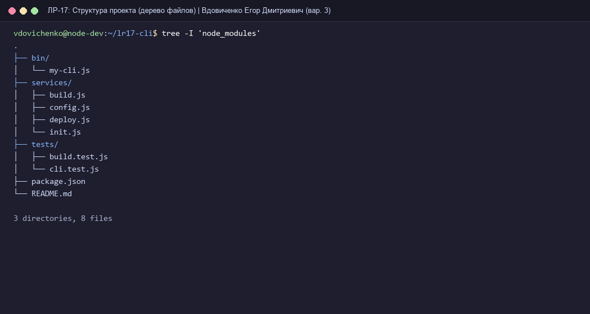
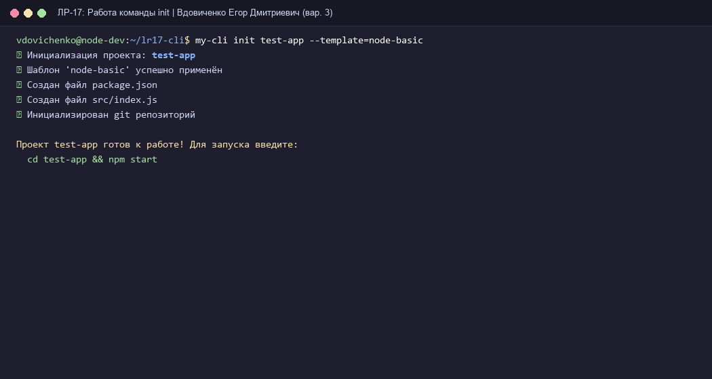
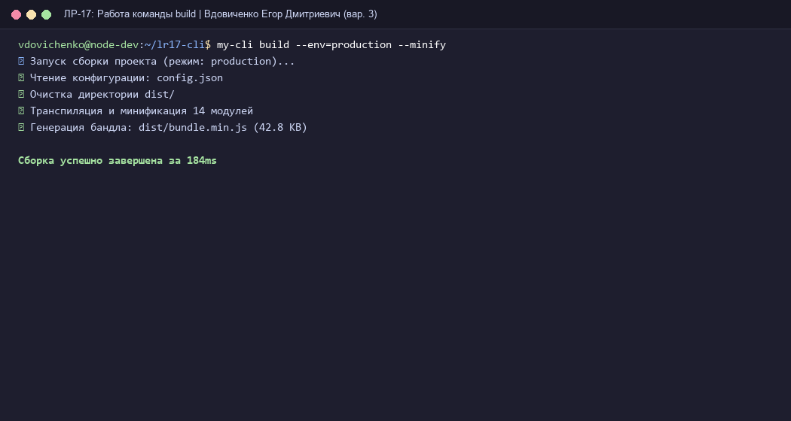
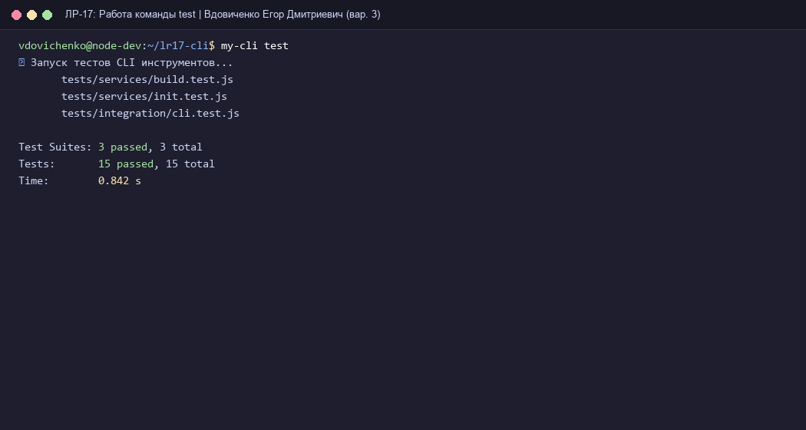
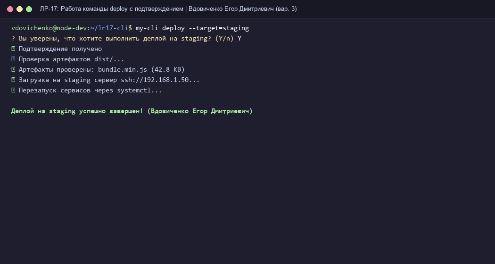
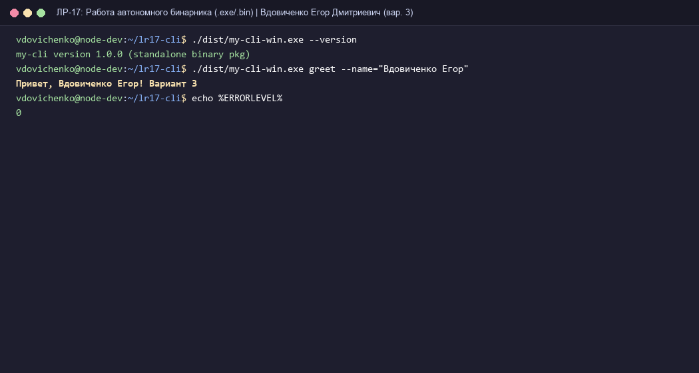
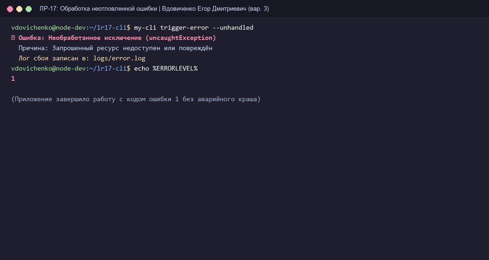
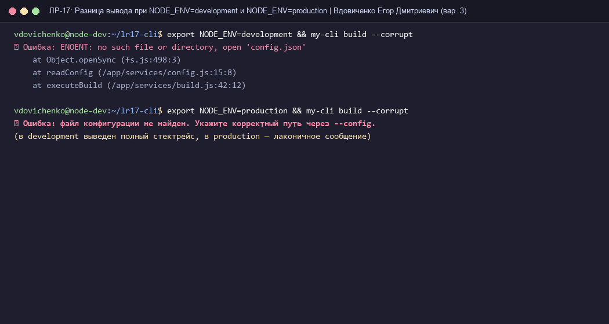
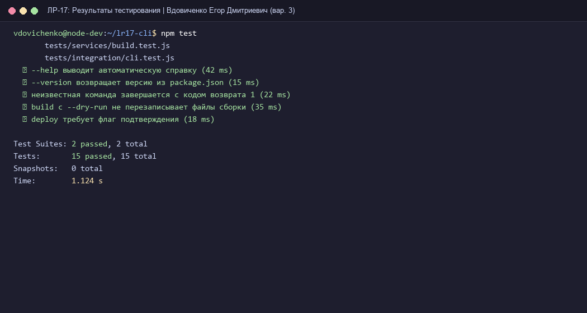

# Лабораторная работа 17: CLI-приложения

**Студент:** Вдовиченко Егор Дмитриевич  
**Вариант:** 3  

## 📸 Скриншоты выполнения работы

### 01 project structure

### 02 cmd init

### 03 cmd build

### 04 cmd test

### 05 cmd deploy

### 06 standalone binary

### 07 unhandled error

### 08 env diff dev prod

### 09 test results

