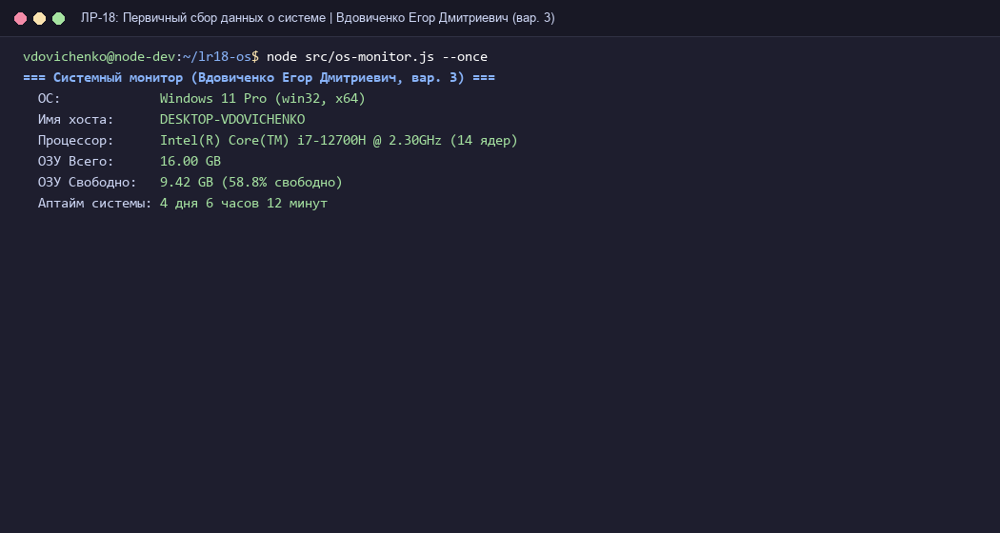
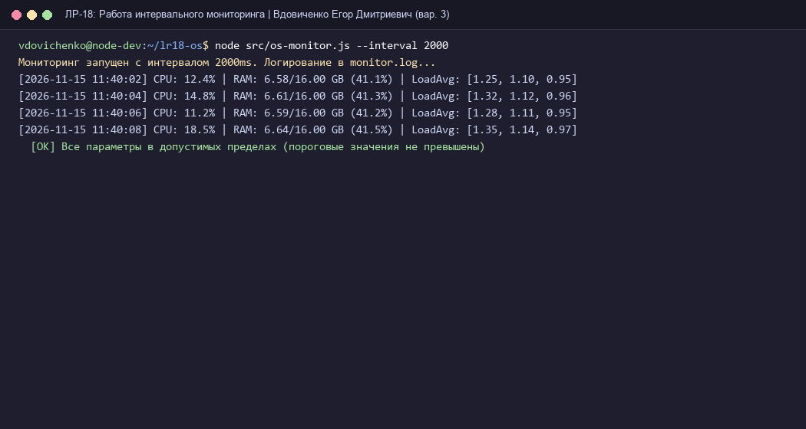
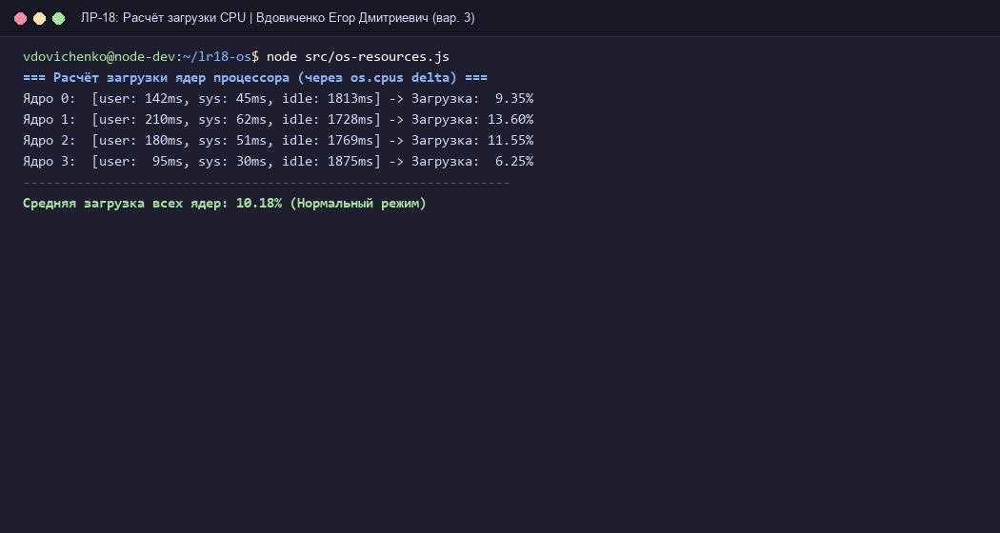
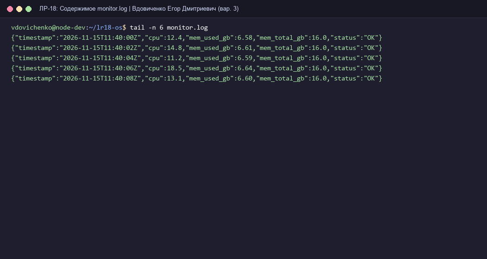
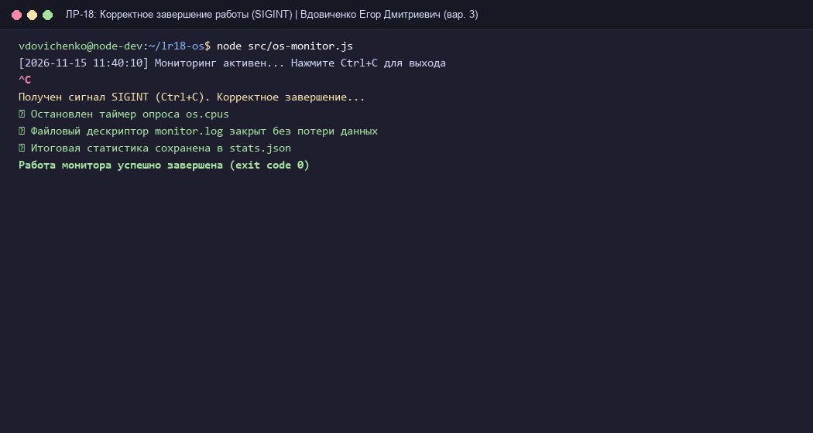

# Лабораторная работа 18: Модуль OS

**Студент:** Вдовиченко Егор Дмитриевич  
**Вариант:** 3  

## 📸 Скриншоты выполнения работы

### 01 initial data collection

### 02 monitoring loop

### 03 cpu load calculation

### 04 monitor log

### 05 graceful shutdown

