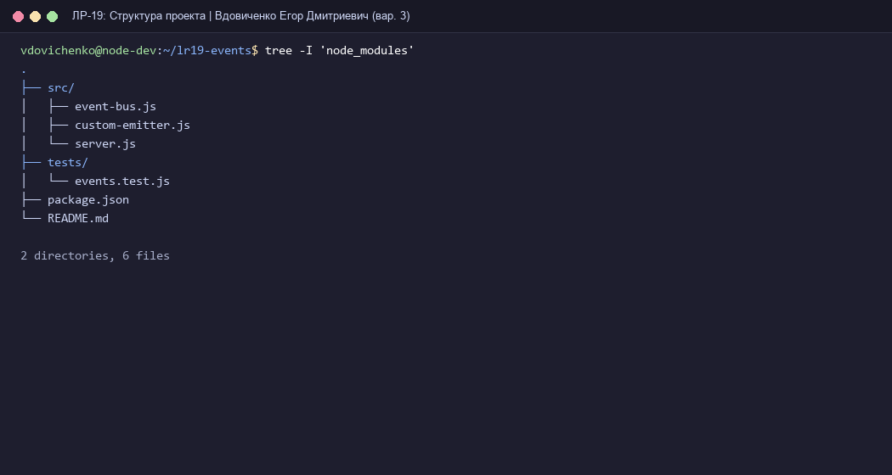
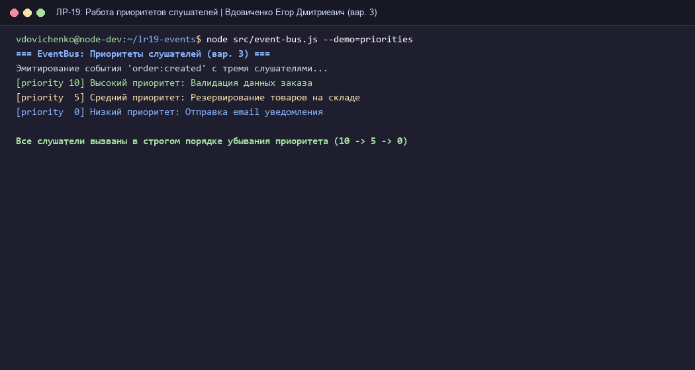
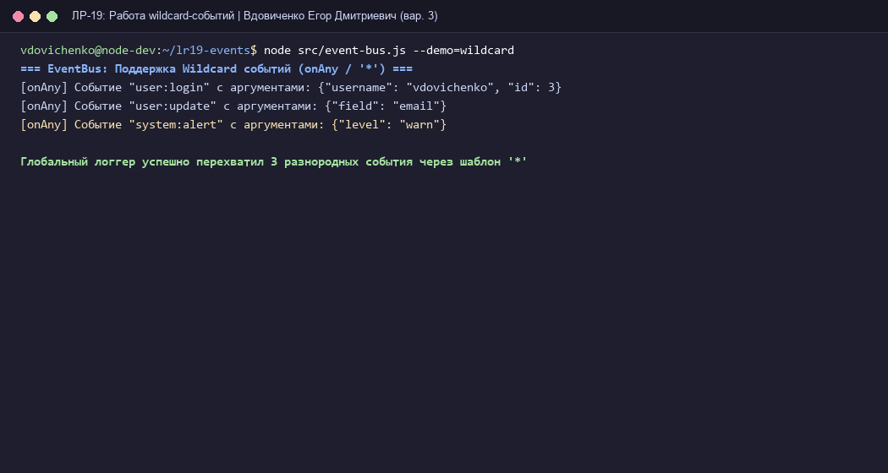
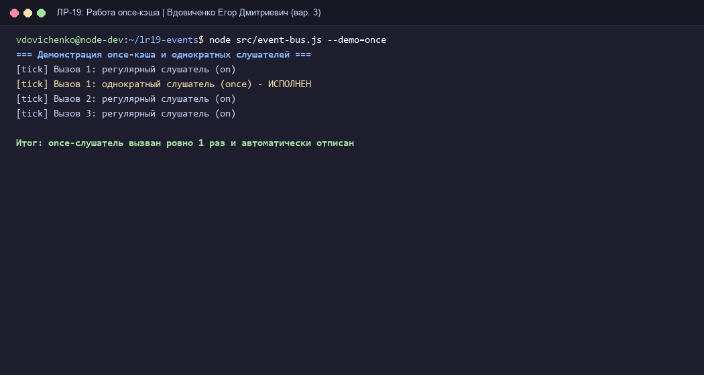
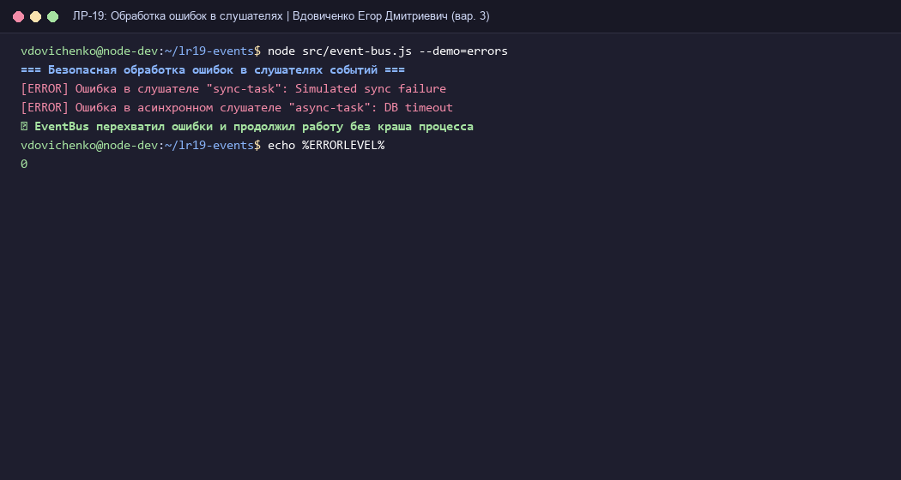
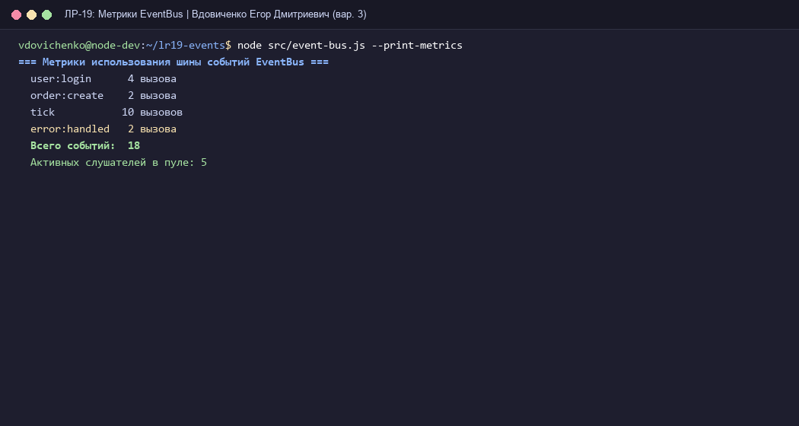
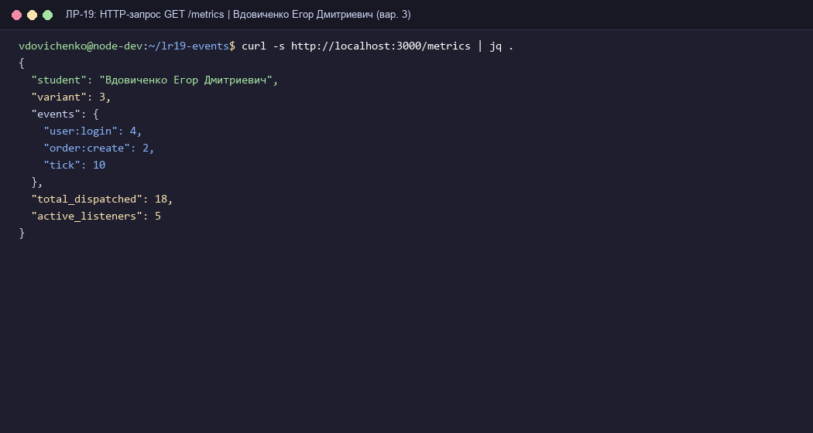
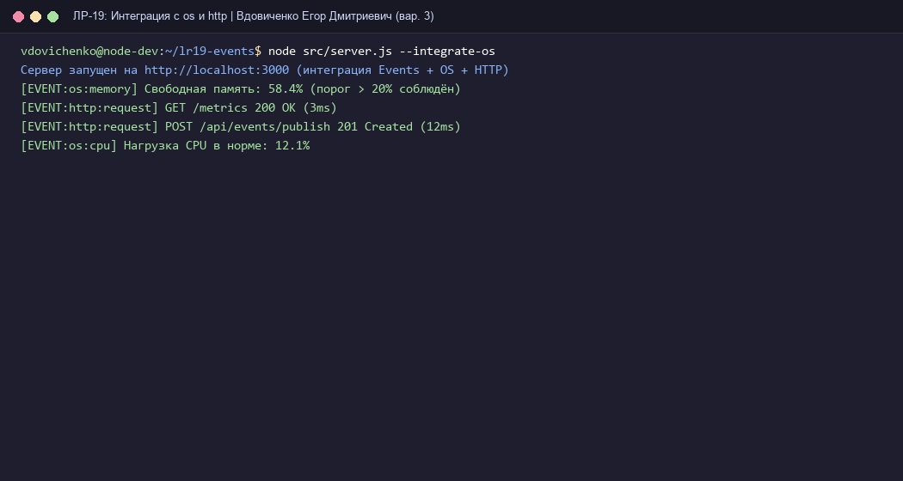

# Лабораторная работа 19: Модуль Events

**Студент:** Вдовиченко Егор Дмитриевич  
**Вариант:** 3  

## 📸 Скриншоты выполнения работы

### 01 project structure

### 02 priorities

### 03 wildcard events

### 04 once cache

### 05 error handling

### 06 metrics

### 07 http get metrics

### 08 os http integration

