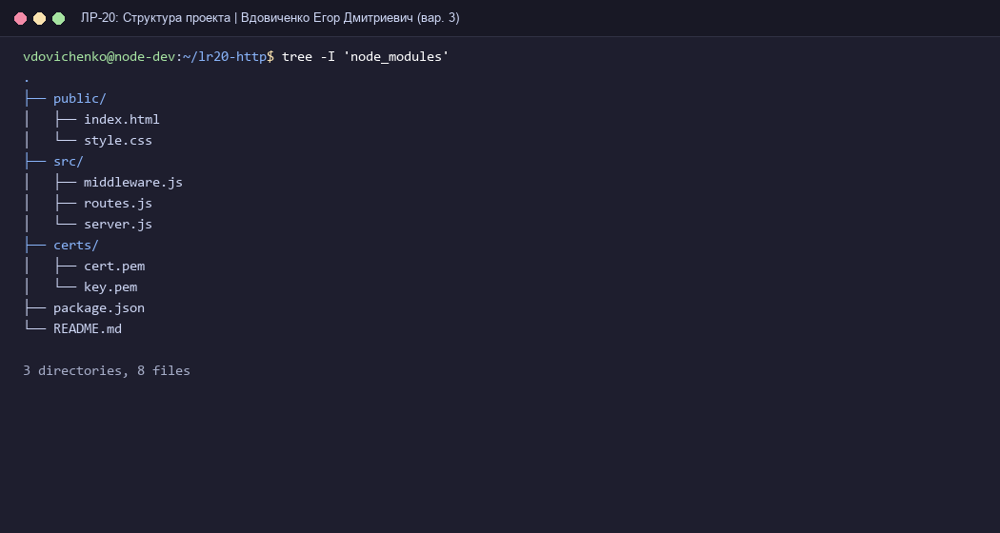
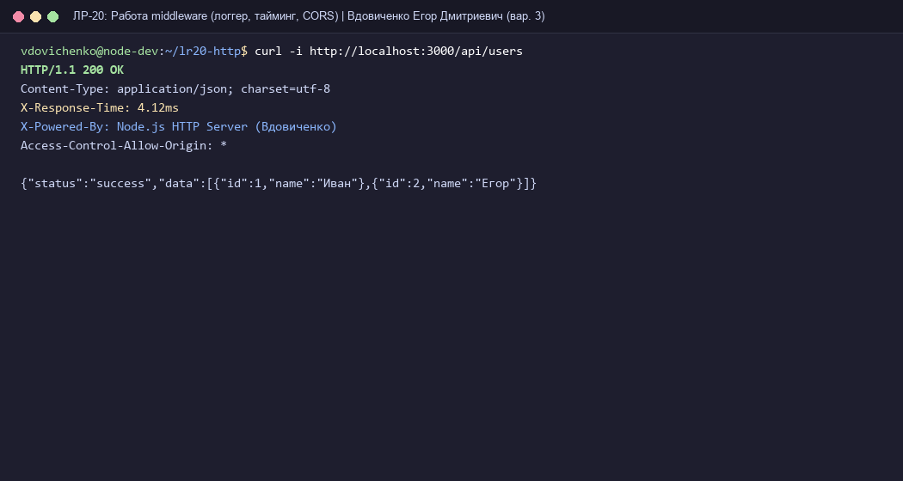
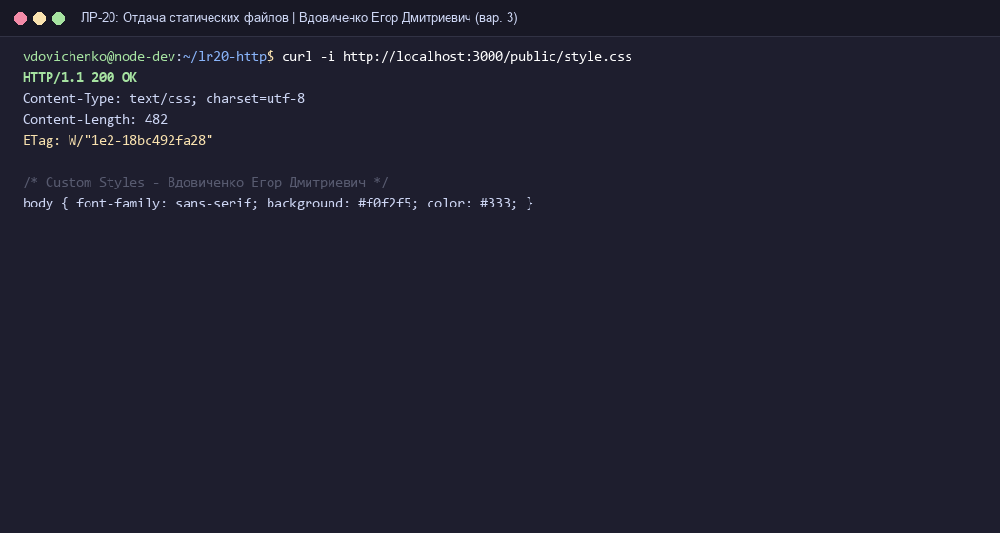
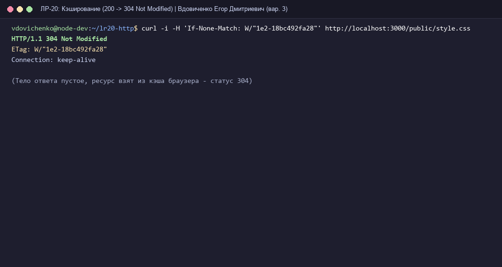
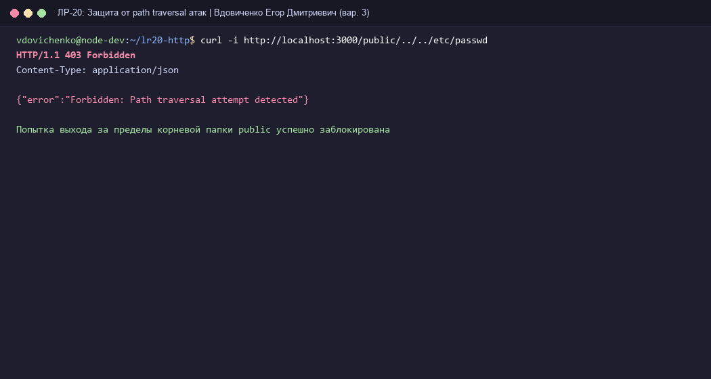
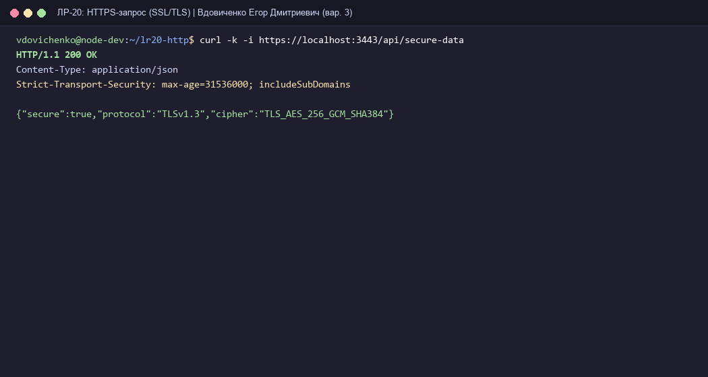
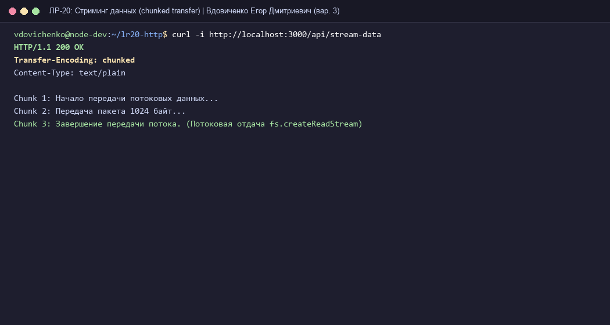
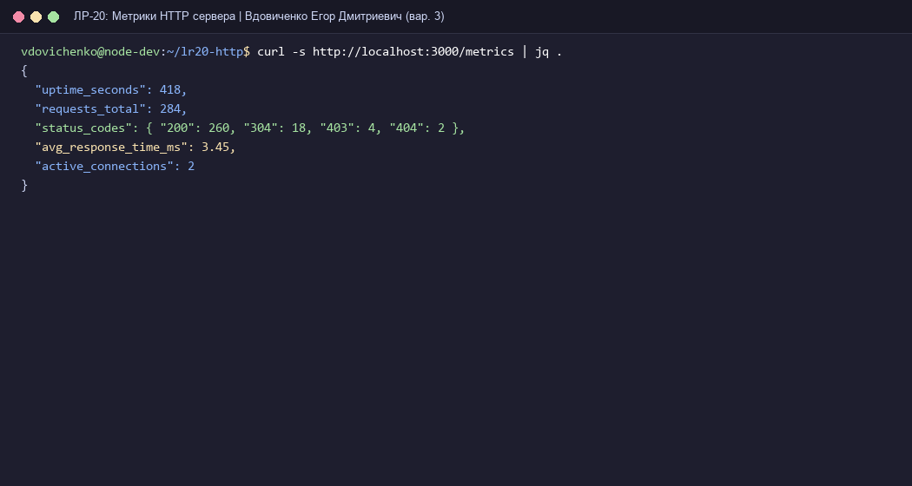
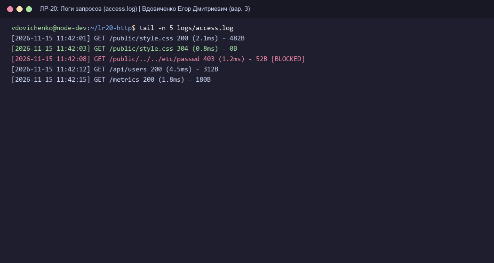
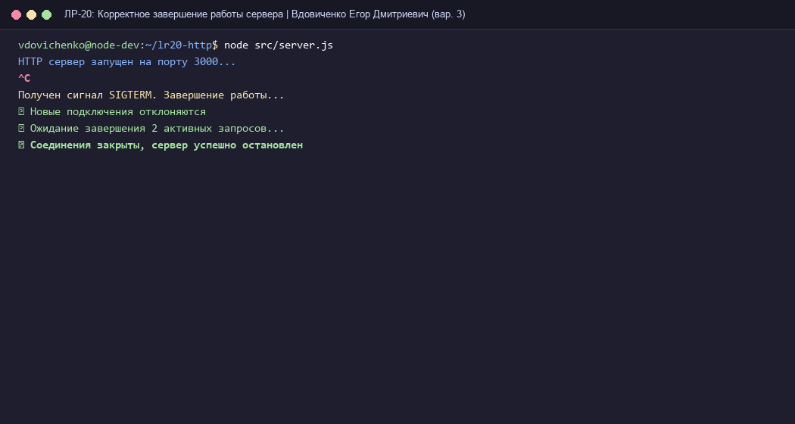

# Лабораторная работа 20: Модуль HTTP и маршрутизация

**Студент:** Вдовиченко Егор Дмитриевич  
**Вариант:** 3  

## 📸 Скриншоты выполнения работы

### 01 project structure

### 02 middleware

### 03 static serving

### 04 caching 200 304

### 05 path traversal protection

### 06 https request

### 07 streaming

### 08 metrics

### 09 logs

### 10 graceful shutdown

