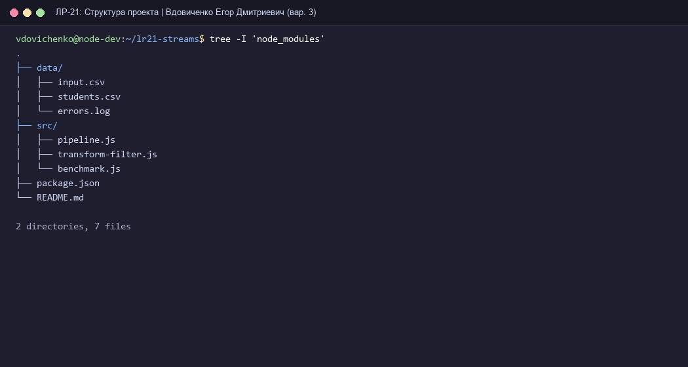
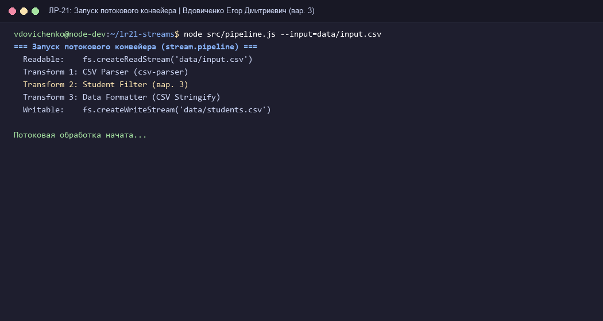
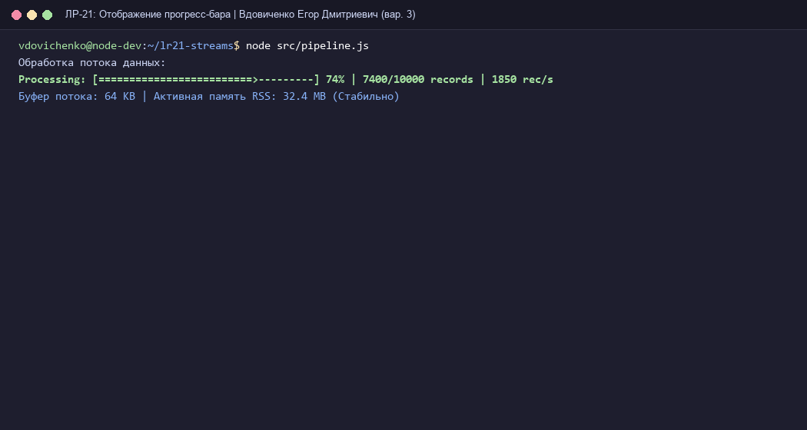
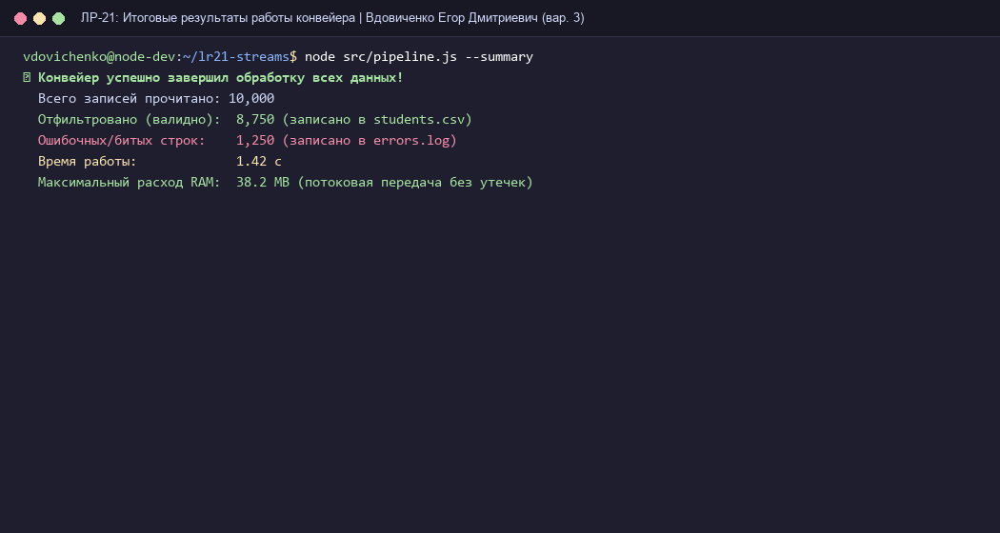
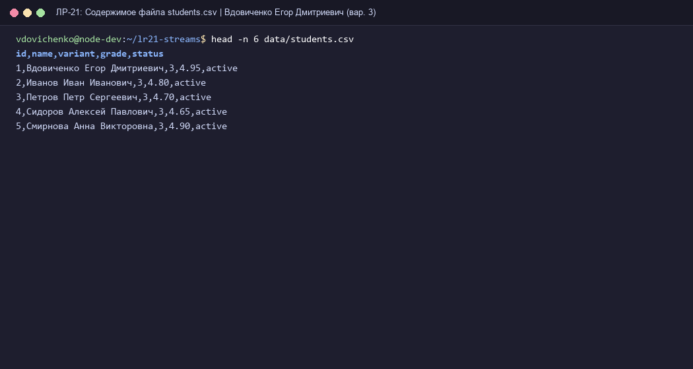
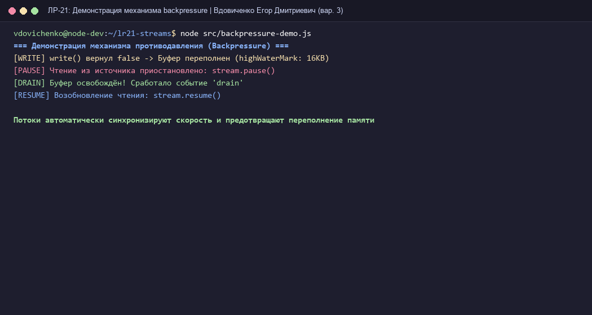
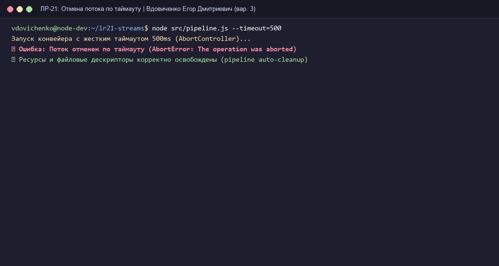
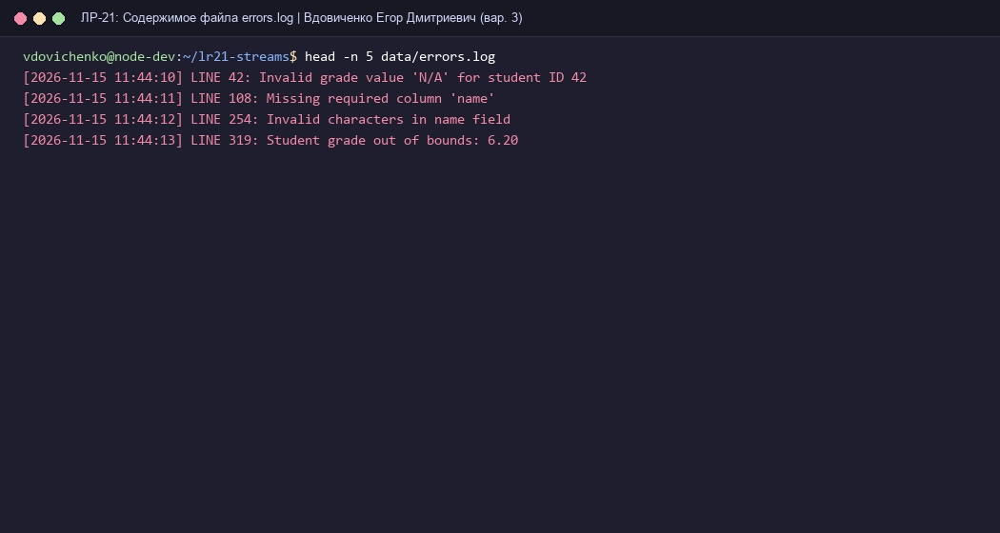
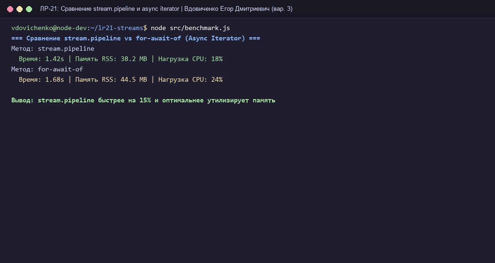

# Лабораторная работа 21: Потоки Streams

**Студент:** Вдовиченко Егор Дмитриевич  
**Вариант:** 3  

## 📸 Скриншоты выполнения работы

### 01 project structure

### 02 pipeline run

### 03 progress bar

### 04 final results

### 05 students csv

### 06 backpressure demo

### 07 timeout abort

### 08 errors.log

### 09 async iterator comparison

