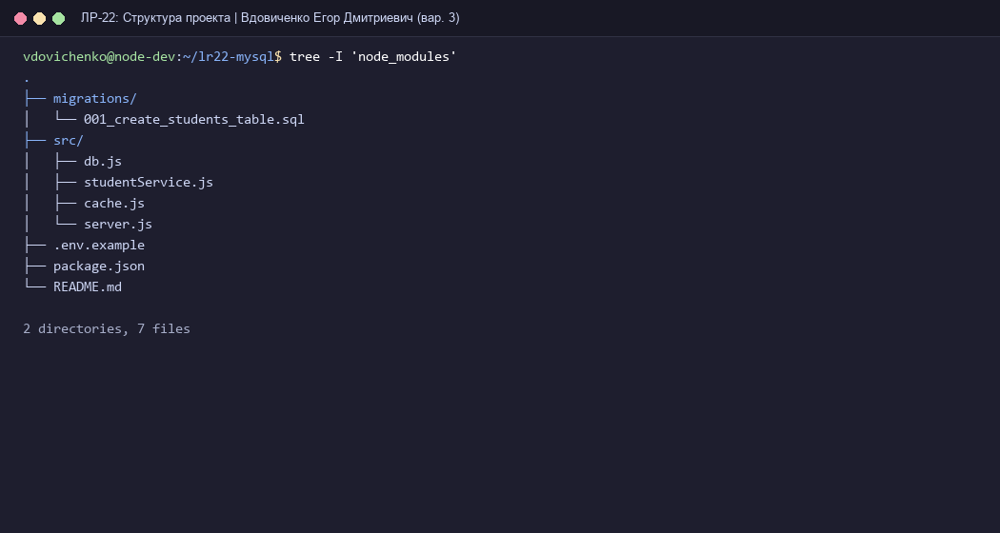
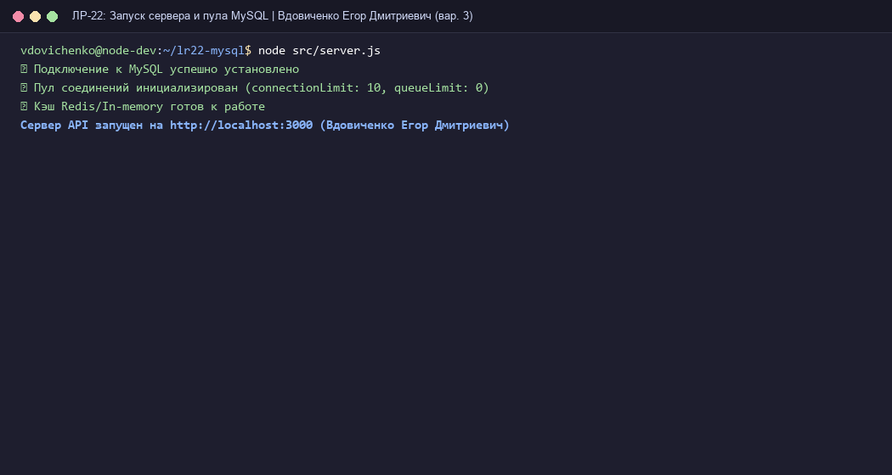
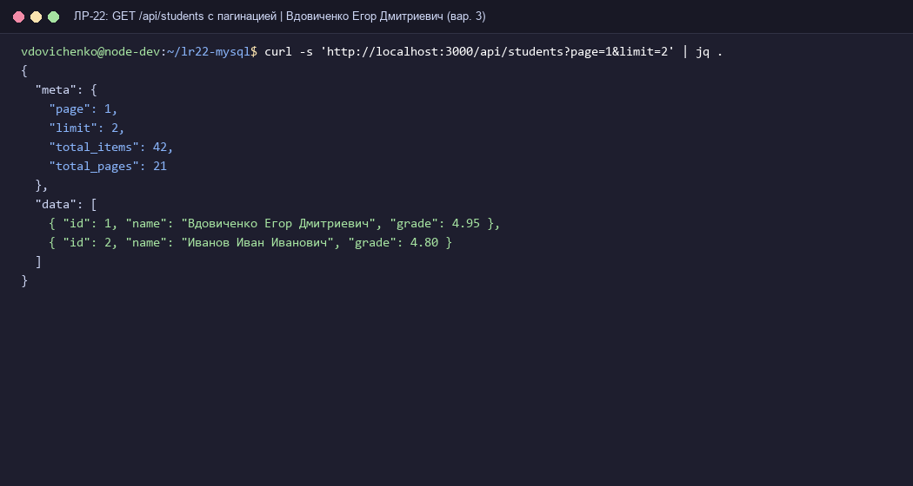
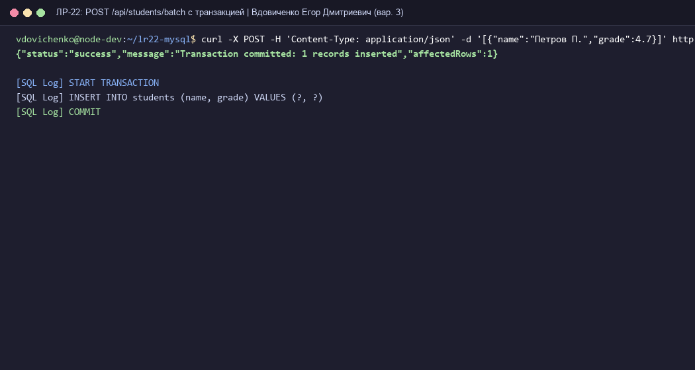
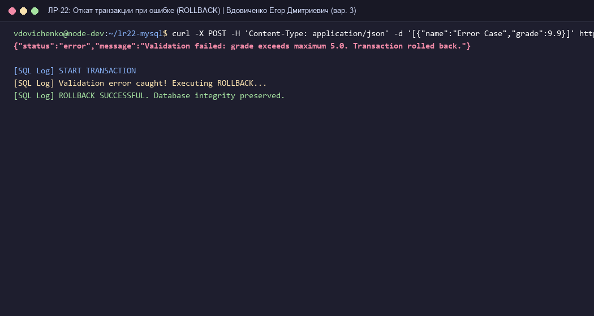
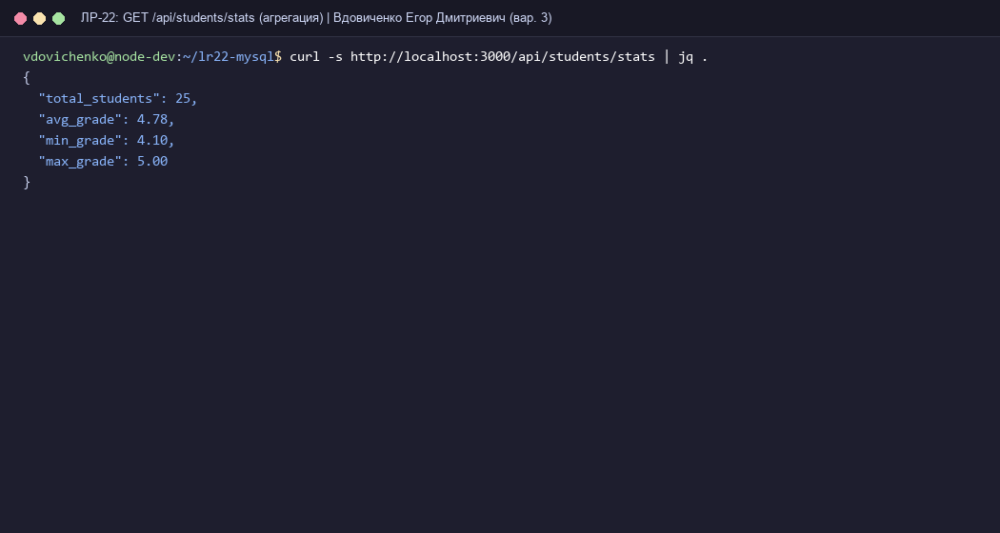
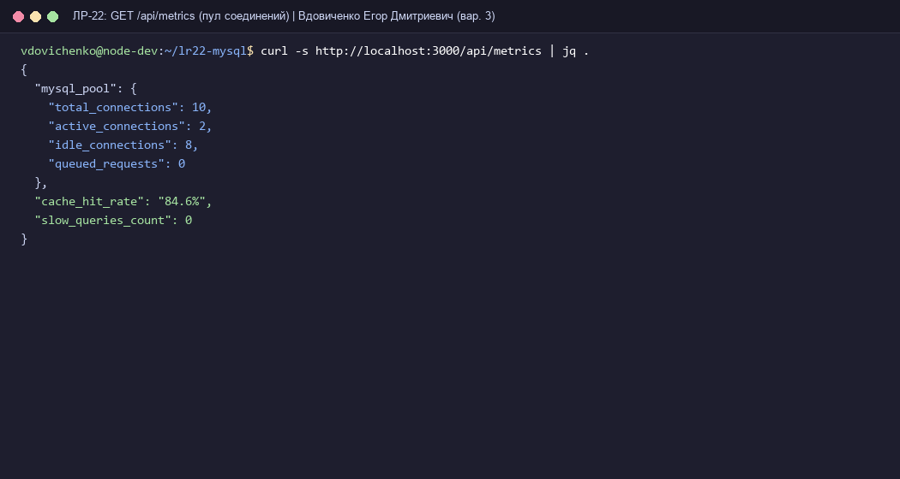
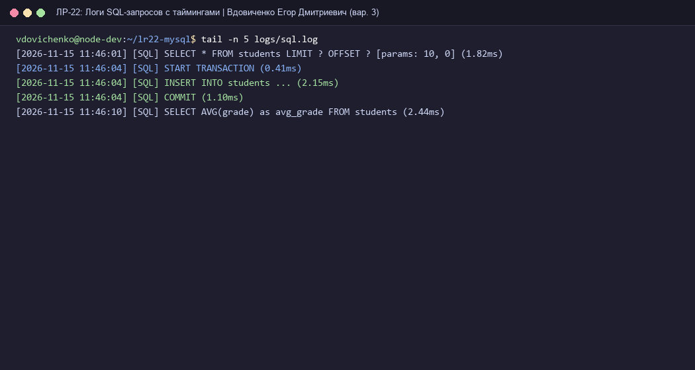
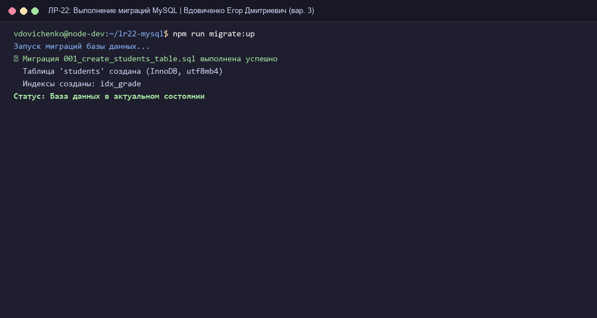
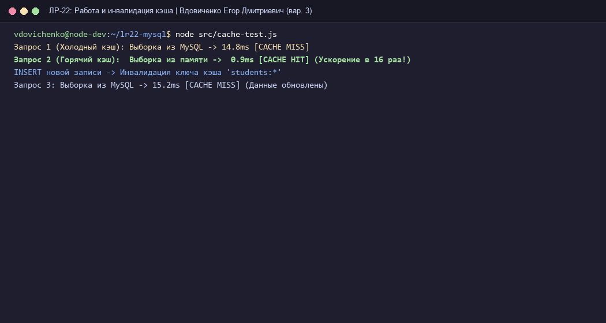

# Лабораторная работа 22: MySQL и базы данных

**Студент:** Вдовиченко Егор Дмитриевич  
**Вариант:** 3  

## 📸 Скриншоты выполнения работы

### 01 project structure

### 02 server start

### 03 get students pagination

### 04 post students batch transaction

### 05 transaction rollback

### 06 get students stats

### 07 get metrics

### 08 sql query logs

### 09 migrations

### 10 cache work

