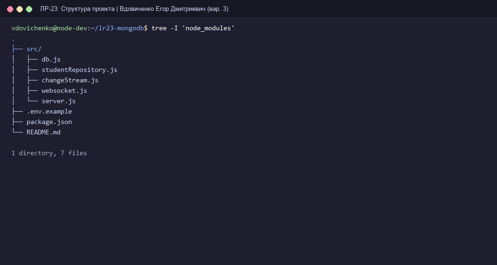
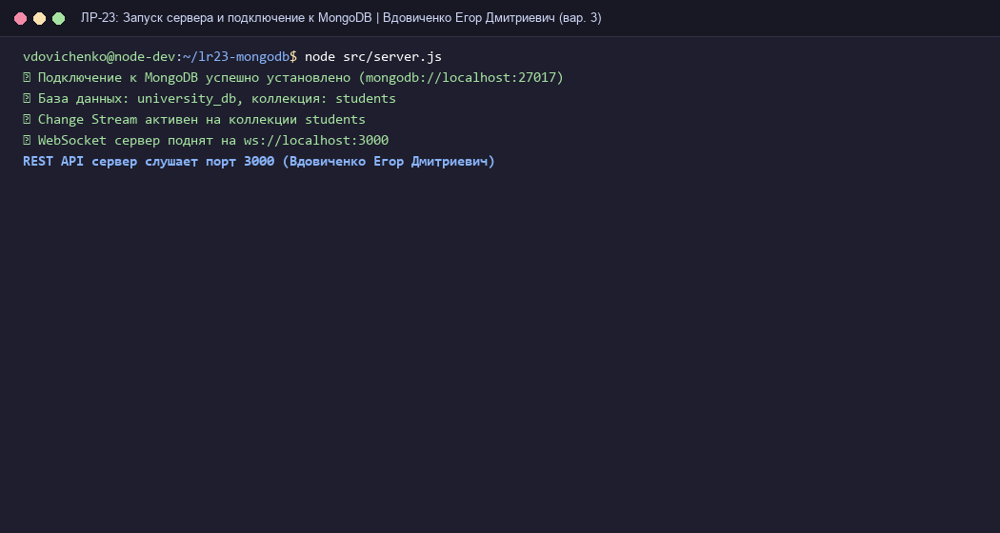
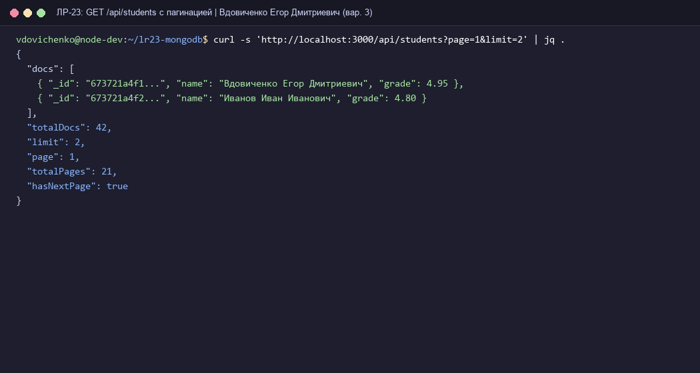
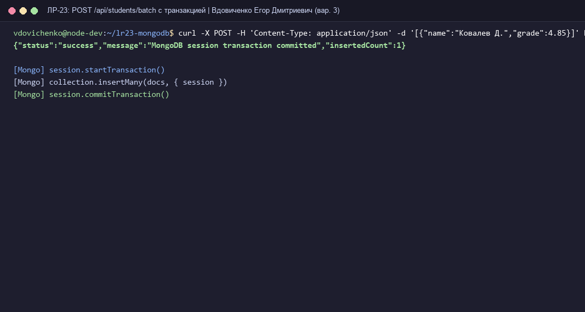
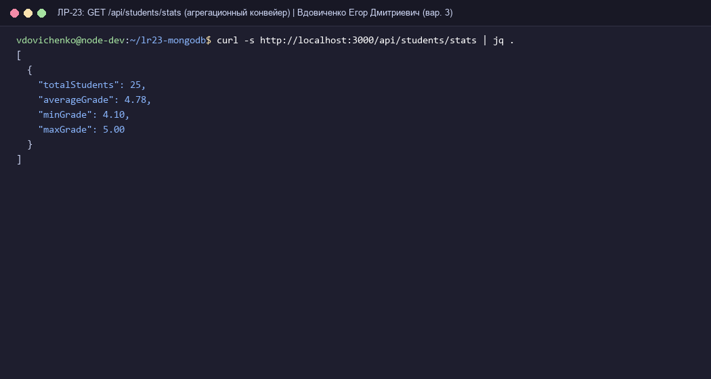
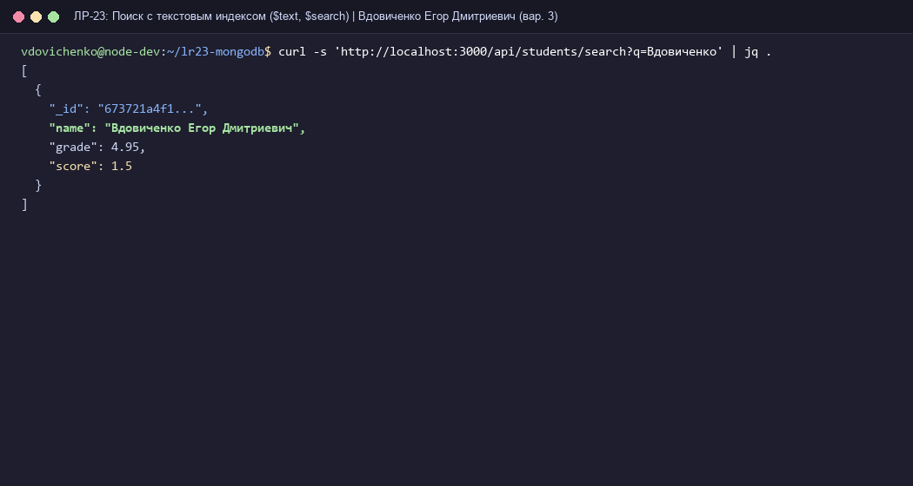
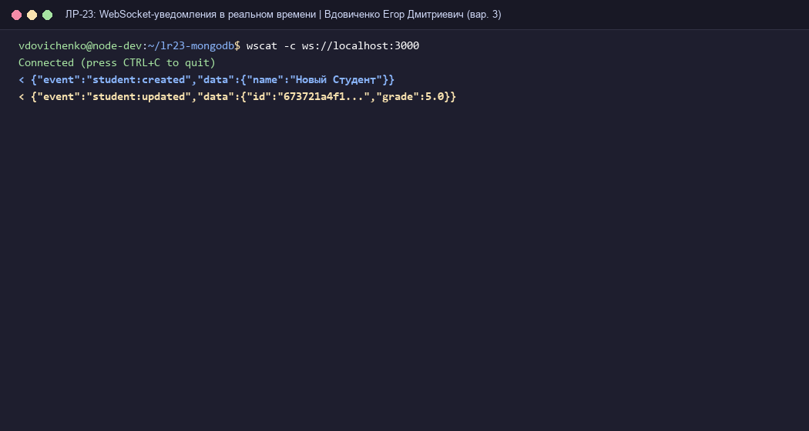
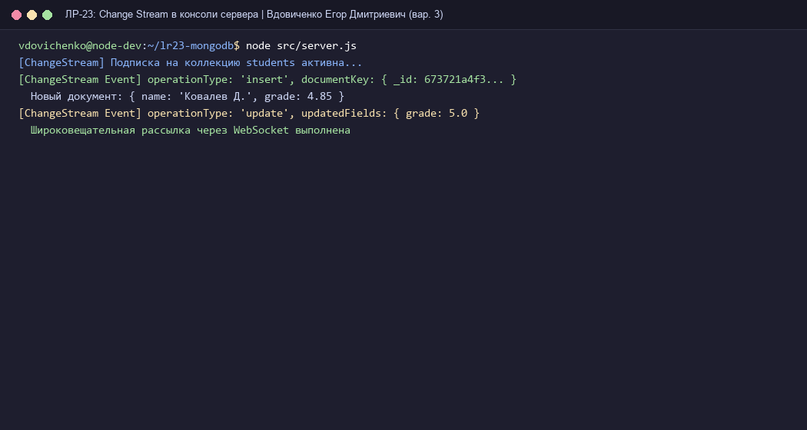
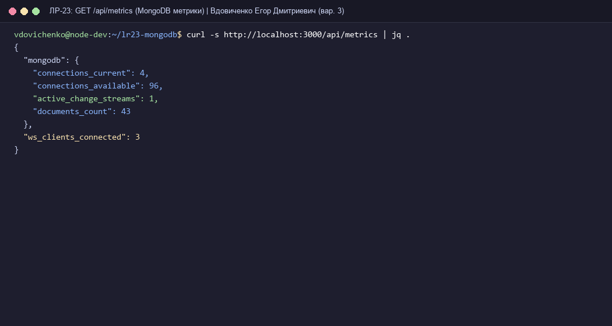
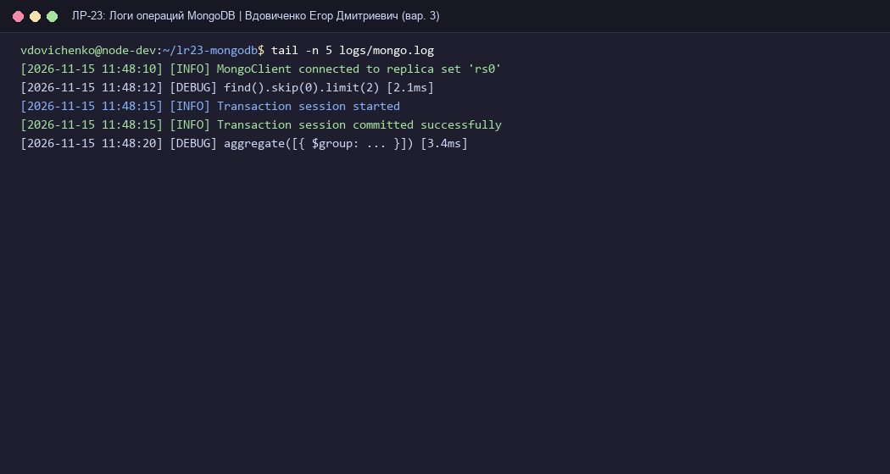

# Лабораторная работа 23: MongoDB

**Студент:** Вдовиченко Егор Дмитриевич  
**Вариант:** 3  

## 📸 Скриншоты выполнения работы

### 01 project structure

### 02 server start

### 03 get students pagination

### 04 post students batch transaction

### 05 get students stats

### 06 text index search

### 07 websocket notifications

### 08 change stream console

### 09 get metrics

### 10 logs

