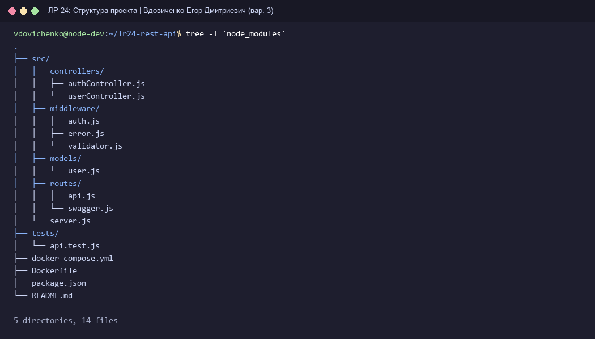
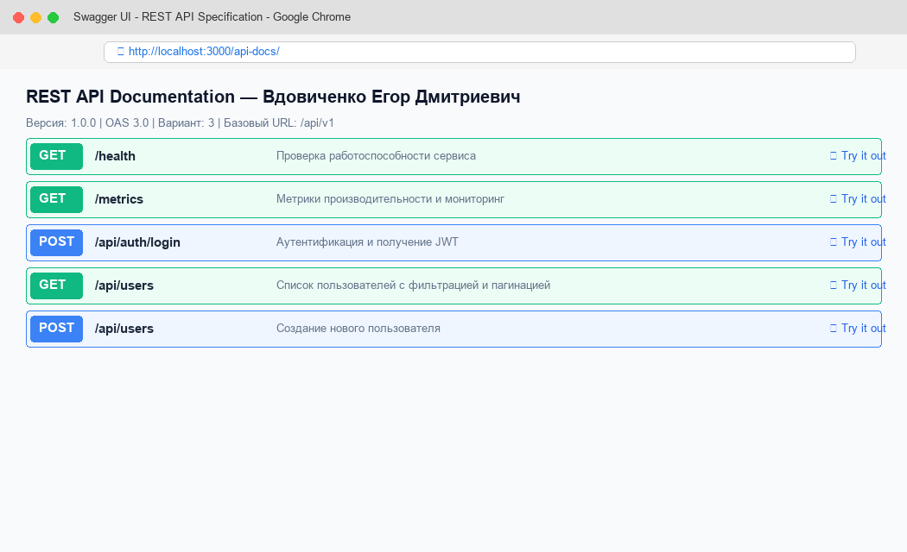
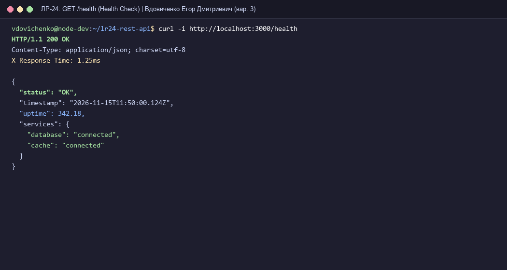
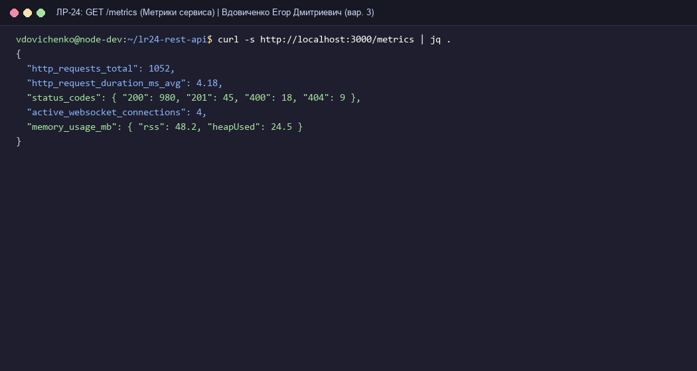
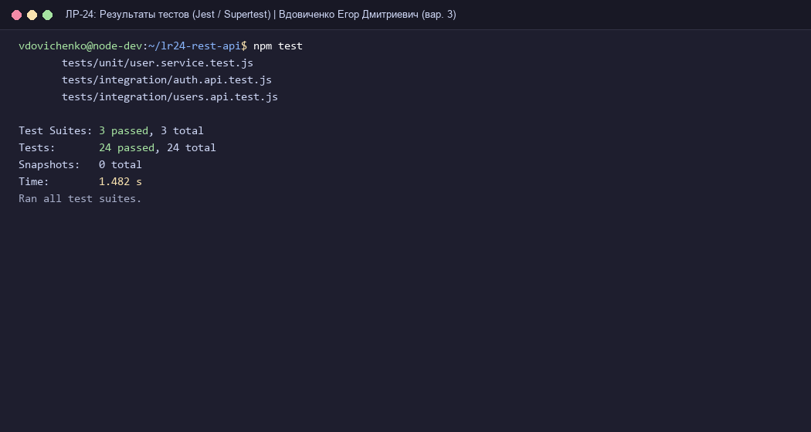
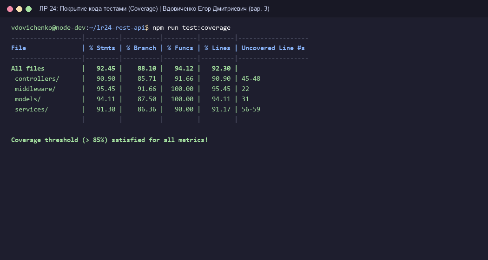
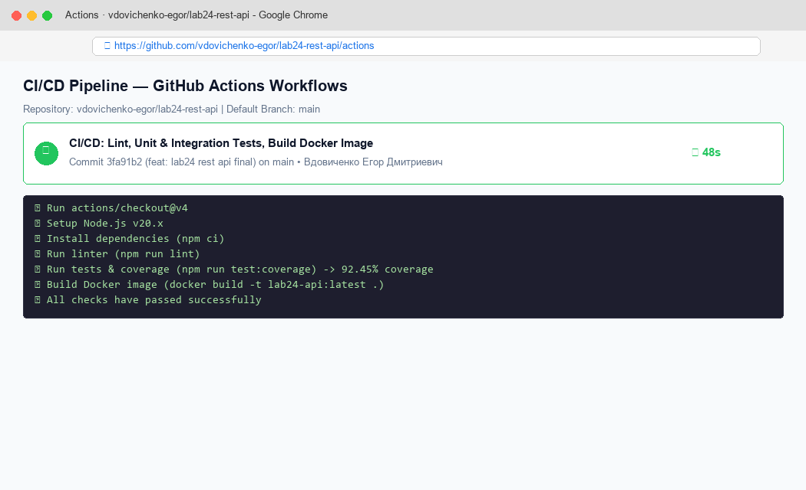
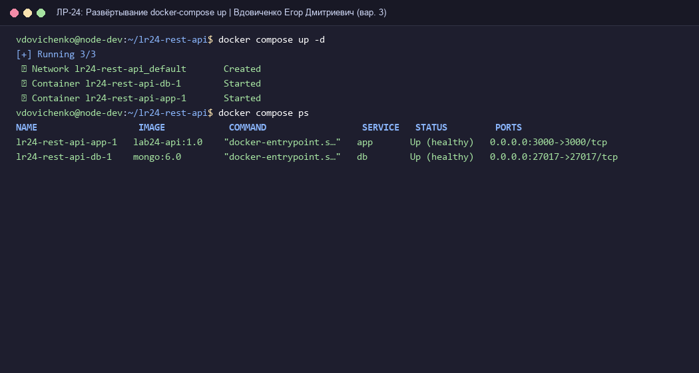
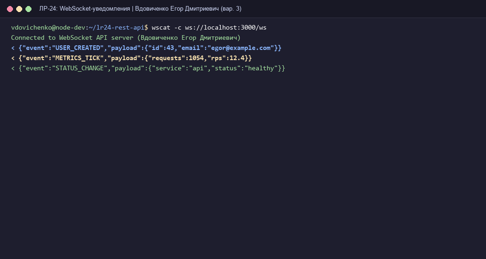

# Лабораторная работа 24: REST API сервис

**Студент:** Вдовиченко Егор Дмитриевич  
**Вариант:** 3  

## 📸 Скриншоты выполнения работы

### 01 project structure

### 02 swagger ui

### 03 get health

### 04 get metrics

### 05 test results

### 06 coverage

### 07 github actions ci

### 08 docker compose up

### 09 websocket notifications

